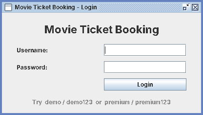

# Movie Ticket Booking System

Java Lab mini project. A desktop app made with Java Swing where a user logs in, picks a movie and chooses seats on a seat map. The user pays with a pretend UPI or card payment and can later view or cancel bookings. Bookings are saved in text files so they stay after the app is closed.

The code is 688 lines in 12 Java files. It uses the concepts from Java Lab Experiments 1 to 11, and each place is marked in the code with a comment like `// Exp 6`.


## What is in this repo

| File or folder | What it is |
|---|---|
| `src/cinema/` | The Java source code (12 files in 4 packages) |
| `run.bat` | Compiles and starts the program on Windows |
| `run.sh` | Compiles and starts the program on Mac or Linux |
| `Movie Ticket Booking System - Lab Journal.pdf` | The lab journal write-up (title, problem statement, objectives, code, screenshots) |
| `Movie Ticket Booking System - Presentation.pptx` | PowerPoint slides for presenting the project: title, problem statement, objective, program and output (12 slides with speaker notes) |
| `screenshots/` | Pictures of the program used in this README |
| `.vscode/` | Settings so VS Code finds the `src` folder |
| `LICENSE` | MIT license |

The `out` and `data` folders are not in the repo. They are made on your computer the first time the program runs.


## Step 1: Install Java

You need the JDK (Java Development Kit), version 8 or newer. The plain JRE is not enough because it has no `javac` compiler.

1. If you do not have it, download a free JDK such as Eclipse Temurin from [adoptium.net](https://adoptium.net) and install it. On Windows keep the installer option that adds Java to the PATH.
2. Open a new Command Prompt (Windows) or Terminal (Mac or Linux) and type:

   ```
   javac -version
   ```

   If it prints a version number like `javac 21.0.2`, Java is ready.


## Step 2: Get the files

**Option A, download a ZIP (easiest):**

1. On this GitHub page click the green **Code** button, then **Download ZIP**.
2. Extract the ZIP. You get a folder called `Movie-Ticket-Booking-System-main`.
3. Use the extracted folder. Do not run anything from inside the ZIP.

**Option B, with Git:**

```
git clone https://github.com/ThatOneRahul/Movie-Ticket-Booking-System.git
cd Movie-Ticket-Booking-System
```


## Step 3: Run the program

**Windows:** open the project folder and double-click `run.bat`. It compiles the code into an `out` folder and opens the login window. If Windows shows a security warning, allow it to run (the file only compiles and starts the program).

**Mac or Linux:** open a terminal in the project folder and type:

```
sh run.sh
```

**By hand** (in a terminal opened in the project folder):

```
javac -d out src/cinema/*.java src/cinema/model/*.java src/cinema/service/*.java src/cinema/ui/*.java
java -cp out cinema.Main
```

**In an IDE:**

- **IntelliJ IDEA:** File > Open and pick the project folder. Right-click `src` and choose Mark Directory as > Sources Root. Open `src/cinema/Main.java` and click the green Run arrow.
- **Eclipse:** make a new Java Project (untick "Create module-info.java"). Copy the `cinema` folder from `src` into the project's `src` folder. Right-click `Main.java` and choose Run As > Java Application.
- **VS Code** (with the Extension Pack for Java): File > Open Folder and pick the project folder. Open `src/cinema/Main.java` and click Run.

The first run makes a `data` folder with two demo users. Bookings are saved there too.


## Demo walkthrough

These steps show every feature in about 5 minutes. The Exp number shows which lab concept each step demonstrates.

**Before the demo:** delete the `data` folder (if there is one) so the demo starts with no old bookings.

1. **Start the program** with `run.bat` (or `sh run.sh`). The login window opens.
2. **Wrong login (Exp 6):** type `premium` with the password `abc` and click Login. An error message shows. This is our own `BookingException`.
3. **Log in as a premium member (Exp 3, 4):** type `premium` / `premium123`. The welcome line says 10% off, because `PremiumCustomer` overrides the method from `Customer`.
4. **Open a show (Exp 10):** Interstellar is already selected. Click **Select Seats**. The 2 minute timer starts counting down at the top right (Exp 8).
5. **Hover and pick seats (Exp 11, 2):** move the mouse over a seat and it turns light green (MouseListener). Click two seats in row C and one in row D. They turn dark green and the total shows the price with the 10% member discount.
6. **Failed payment (Exp 6):** leave Pay by on UPI, type `test` in the UPI ID box and click **Confirm and Pay**. The payment fails because a UPI ID needs an `@`, and no seats are booked.
7. **Successful booking (Exp 4, 7, 8):** type `premium@okaxis` and click **Confirm and Pay**. A message shows the booking id (BK1001) and the amount paid. The booking is saved in `data/bookings.txt`.
8. **Seats left go down:** back on the movie list, Interstellar now shows 37 seats left.
9. **Booked seat (Exp 6):** click **Select Seats** again. The seats you booked are red. Click a red seat and a warning says it is already booked. Click **Back**.
10. **Card payment:** select another movie, pick a seat in row E, choose **Card** and type `4111 1111 1111 1111`. Confirm the booking.
11. **My Bookings (Exp 9, 10):** click **My Bookings**. A table lists both bookings. Click one row, click **Cancel Selected Booking** and then **Yes**. The seats are free again and the file is saved again (Iterator in `cancelBooking()`).
12. **Data is saved (Exp 7):** close the program and start it again. Log in as `premium` and open **My Bookings**. The booking that was not cancelled is still there. You can also open `data/bookings.txt` in Notepad to show the saved line.
13. **Normal user:** log in as `demo` / `demo123` and pick the same kind of seats. The total has no discount, which shows the two `calculatePrice()` methods (Exp 2) giving different results.

**Showing the timer run out (Exp 8):** open a seat screen, pick a seat and wait 2 minutes. A "Time is up" message shows and the seat is released. To show this faster, open `src/cinema/ui/SeatDialog.java`, change `private int secondsLeft = 120;` to `private int secondsLeft = 10;`, save and run `run.bat` again. Change it back after the demo.


## Logins and test values

| Username | Password | Type |
|---|---|---|
| demo | demo123 | Normal customer |
| premium | premium123 | Premium customer (10% off every booking) |

- A UPI ID must look like `name@bank`, for example `premium@okaxis`
- A card number must have 16 digits, for example `4111 1111 1111 1111`
- Payment is pretend only. No real money is taken and card numbers are not saved
- Rows A to C are normal seats. Rows D and E are premium seats and cost Rs. 100 extra
- You get 2 minutes to finish a booking. After that the selected seats are released


## Troubleshooting

| Problem | Fix |
|---|---|
| `'javac' is not recognized` or `javac: command not found` | The JDK is not installed or not on the PATH. Do Step 1 again, then open a new Command Prompt or Terminal |
| The `run.bat` window closes at once | Open Command Prompt in the project folder and type `run.bat` to see the error message |
| `Could not find or load main class cinema.Main` | Run the commands from the project folder (the one that has `src` in it), or use `run.bat` |
| Old bookings show up in the demo | Close the program and delete the `data` folder. It is made again with the two demo users |
| The code does not compile in Eclipse or IntelliJ | Make sure the `cinema` folder sits directly inside the source folder, so the path is `src/cinema/Main.java` |


## Project structure

```
src/cinema/
    Main.java                  14   starts the app
    model/
        Seat.java              27   Seat and PremiumSeat
        User.java              35   abstract User, Customer and PremiumCustomer
        Movie.java             43   one show with its 40 seats
        Booking.java           42   one confirmed booking
        BookingException.java   8   our own exception
    service/
        BookingService.java    95   login, price, booking and cancel
        FileHandler.java       57   reads and writes the text files
        Payable.java           34   Payable interface, UpiPayment and CardPayment
    ui/
        LoginFrame.java        51   login form
        MovieFrame.java        86   movie list and My Bookings table
        SeatDialog.java       196   seat map, payment and the countdown thread
```


## Where each experiment is used

| Exp | Concept | Where it is used |
|---|---|---|
| 1 | Class, object and constructors | `Seat`, `Movie` and `Booking` classes. `Booking` has two constructors: one for a new booking and one for a booking loaded from the file |
| 2 | Method overloading and static keyword | Two `calculatePrice()` methods in `BookingService`. A static counter in `Booking` makes ids like BK1001. Static methods `User.create()`, `Seat.create()`, `Payable.create()` and all `FileHandler` methods |
| 3 | Single and multilevel inheritance | Single: `Seat` to `PremiumSeat`. Multilevel: `User` to `Customer` to `PremiumCustomer` |
| 4 | Interfaces and abstract classes | `User` is abstract. `Payable` is an interface that `UpiPayment` and `CardPayment` implement |
| 5 | User-defined packages | `cinema.model`, `cinema.service` and `cinema.ui`, imported where needed |
| 6 | Exception handling and user-defined exceptions | `BookingException` for a wrong login, a booked seat or a failed payment. try, catch and finally in `SeatDialog.confirm()`. A multi-catch in `FileHandler` skips damaged lines |
| 7 | File read/write | `FileHandler` reads and writes `data/users.txt` and `data/bookings.txt` with `BufferedReader` and `BufferedWriter` |
| 8 | Multithreading | The `CountdownTimer` inner class in `SeatDialog` extends `Thread`. `bookSeats()` is `synchronized` |
| 9 | ArrayList, HashMap and iterators | `HashMap` of users and seat buttons. `ArrayList` of bookings and selected seats. `Iterator` in `cancelBooking()` |
| 10 | Swing GUI | Login form, movie list (`JList`), seat map (grid of `JButton`) and bookings table (`JTable`) |
| 11 | ActionListener and MouseListener | Every screen implements `ActionListener`. `SeatDialog` implements `MouseListener` for the hover color on the seats |


## Screenshots

| Login | Booking confirmed | My Bookings |
|---|---|---|
|  |  |  |


## Data files

`data/users.txt` has one user per line, for example `demo,demo123,NORMAL`.

`data/bookings.txt` has one booking per line (id, username, movie, seats, amount, payment), for example `BK1001,premium,M1,C1;C2;D1,630.0,UPI`.

Delete the `data` folder to start fresh. It is made again with the two demo users.
