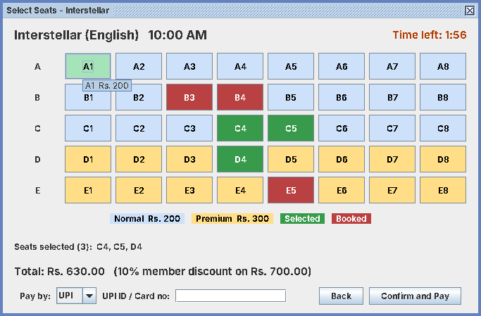
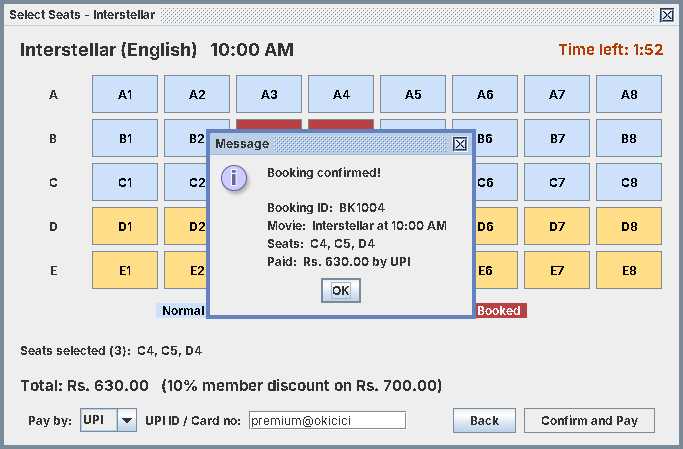
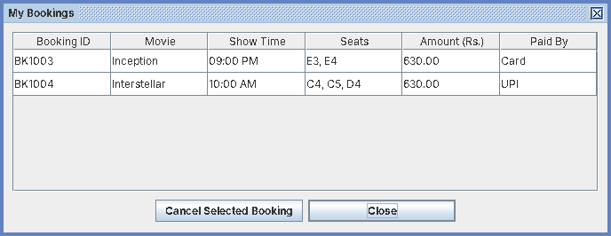

# Movie Ticket Booking System

Java Lab mini project. A desktop app made with Java Swing where a user logs in, picks a movie and chooses seats on a seat map. The user pays with a pretend UPI or card payment and can later view or cancel bookings. Bookings are saved in text files so they stay after the app is closed.

The code is 688 lines in 12 Java files. It uses the concepts from Java Lab Experiments 1 to 11, and each place is marked in the code with a comment like `// Exp 6`.




## How to run

You need the JDK (Java 8 or newer). No extra libraries are needed.

**Windows:** double-click `run.bat`

**Mac or Linux:** open a terminal in this folder and type `sh run.sh`

**By hand** (inside this folder):

```
javac -d out src/cinema/*.java src/cinema/model/*.java src/cinema/service/*.java src/cinema/ui/*.java
java -cp out cinema.Main
```

**IntelliJ IDEA:** open this folder, right-click `src` and choose Mark Directory as > Sources Root, then run `src/cinema/Main.java`.

**Eclipse:** make a new Java Project (untick "Create module-info.java"), copy the `cinema` folder into its `src` folder and run `Main.java`.

**VS Code** (with the Extension Pack for Java): open this folder and run `Main.java`.

The app makes a `data` folder where it is run. That is where users and bookings are saved.


## Logins and test values

| Username | Password | Type |
|---|---|---|
| demo | demo123 | Normal customer |
| premium | premium123 | Premium customer (10% off every booking) |

- A UPI ID must look like `name@bank` and a card number must have 16 digits. Payment is pretend only
- Rows A to C are normal seats. Rows D and E are premium seats and cost Rs. 100 extra
- You get 2 minutes to finish a booking. After that the selected seats are released


## Project structure

```
src/cinema/
    Main.java                  14   starts the app
    model/
        Seat.java              27   Seat and PremiumSeat
        User.java              35   abstract User, Customer and PremiumCustomer
        Movie.java             43   one show with its 40 seats
        Booking.java           42   one confirmed booking
        BookingException.java   8   our own exception
    service/
        BookingService.java    95   login, price, booking and cancel
        FileHandler.java       57   reads and writes the text files
        Payable.java           34   Payable interface, UpiPayment and CardPayment
    ui/
        LoginFrame.java        51   login form
        MovieFrame.java        86   movie list and My Bookings table
        SeatDialog.java       196   seat map, payment and the countdown thread
```


## Where each experiment is used

| Exp | Concept | Where it is used |
|---|---|---|
| 1 | Class, object and constructors | `Seat`, `Movie` and `Booking` classes. `Booking` has two constructors: one for a new booking and one for a booking loaded from the file |
| 2 | Method overloading and static keyword | Two `calculatePrice()` methods in `BookingService`. A static counter in `Booking` makes ids like BK1001. Static methods `User.create()`, `Seat.create()`, `Payable.create()` and all `FileHandler` methods |
| 3 | Single and multilevel inheritance | Single: `Seat` to `PremiumSeat`. Multilevel: `User` to `Customer` to `PremiumCustomer` |
| 4 | Interfaces and abstract classes | `User` is abstract. `Payable` is an interface that `UpiPayment` and `CardPayment` implement |
| 5 | User-defined packages | `cinema.model`, `cinema.service` and `cinema.ui`, imported where needed |
| 6 | Exception handling and user-defined exceptions | `BookingException` for a wrong login, a booked seat or a failed payment. try, catch and finally in `SeatDialog.confirm()`. A multi-catch in `FileHandler` skips damaged lines |
| 7 | File read/write | `FileHandler` reads and writes `data/users.txt` and `data/bookings.txt` with `BufferedReader` and `BufferedWriter` |
| 8 | Multithreading | The `CountdownTimer` inner class in `SeatDialog` extends `Thread`. `bookSeats()` is `synchronized` |
| 9 | ArrayList, HashMap and iterators | `HashMap` of users and seat buttons. `ArrayList` of bookings and selected seats. `Iterator` in `cancelBooking()` |
| 10 | Swing GUI | Login form, movie list (`JList`), seat map (grid of `JButton`) and bookings table (`JTable`) |
| 11 | ActionListener and MouseListener | Every screen implements `ActionListener`. `SeatDialog` implements `MouseListener` for the hover color on the seats |


## Screenshots

| Login | Booking confirmed | My Bookings |
|---|---|---|
|  |  |  |


## Data files

`data/users.txt` has one user per line, for example `demo,demo123,NORMAL`.

`data/bookings.txt` has one booking per line (id, username, movie, seats, amount, payment), for example `BK1001,demo,M1,A1;A2,400.0,UPI`.

Delete the `data` folder to start fresh. It is made again with the two demo users.
